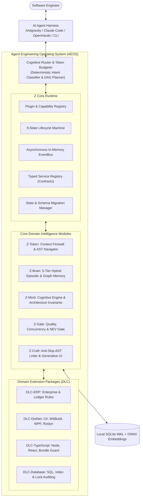

# 00. Executive Summary: Z-Plugin Evolution into Agent Engineering Operating System (AEOS)

## 1. Vision & Executive Mandate

The objective of this initiative is to elevate `z-plugin` from a loose collection of platform-specific plugins into a vendor-agnostic, resilient, local-first **Agent Engineering Operating System (AEOS)**. 

Modern AI coding agents (Claude Code, Google Antigravity, OpenHands, Codex, Gemini CLI) exhibit high generative capability but suffer from five fundamental operational failure modes:
1. **Context Bloat & Token Amnesia**: Agents read entire codebases eagerly, exceeding context windows, degrading reasoning quality, and incurring massive token costs.
2. **Episodic Forgetting**: Lessons learned in prior debugging or refactoring sessions vanish once the terminal session terminates, causing identical regressions to recur repeatedly.
3. **Unchecked Cognitive Drift**: Agents bypass architectural boundaries, introduce speculative abstractions ("wrapper hell"), create dead interactions, and aggrandize output without empirical proof.
4. **Shallow Code Perception**: Agents rely on blunt string grep rather than Abstract Syntax Trees (AST) or Language Server Protocol (LSP) semantic graphs, missing references and misinterpreting signatures.
5. **Brittle Inter-Tool Coupling**: Custom tools and plugins interoperate via ad-hoc filesystem relative imports, lacking lifecycle management, capability negotiation, fault isolation, and permission boundaries.

AEOS transforms `z-plugin` into the foundational infrastructure layer that solves these five failure modes universally across any AI coding agent, while preserving a **Local-First, Resource-Efficient, and Zero-Vendor-Lock-in** engineering standard.

---

## 2. Core Audit Findings & Architectural Verdict

A rigorous, line-by-line source code audit was conducted on `z-plugin` v1.1.0 (`C:\Users\phong.vo\source\repos\z-plugin`). The audit revealed exceptional tactical strengths alongside severe structural architectural bottlenecks:

### 2.1 The Tactical Strengths (What Is Proven & Working)
- **Zero-External-Dependency Discipline**: The suite runs entirely on native Node.js 22 built-ins (`node:sqlite`, `node:fs`, `node:path`, `node:child_process`), keeping cold startup latency under 15ms and memory footprint under 28MB RSS.
- **Empirically Proven Token Defense**: `z-token`'s `guard.mjs` PreToolUse hook reliably prevents context flooding, delivering 81.6% to 99.2% token savings on large files, recursive grep, and build logs (verified via `bench/measure.mjs`).
- **High-Speed Local Storage**: `z-brain` utilizes SQLite in `WAL` mode with `PRAGMA synchronous = NORMAL`, achieving sub-millisecond full-text searches via `fts5` virtual tables.
- **Strict Invariant Governance**: `z-mind`'s 56 rules and `z-gate`'s Net Engineering Value (NEV) auditor effectively identify single-implementation interface bloat ("wrapper hell") and line-of-code inflation.

### 2.2 The Structural Bottlenecks (What Limits Scalability)
- **Ad-Hoc Filesystem Coupling**: Plugins import code from sibling directories via hardcoded relative paths (e.g., `await import('../../../z-brain/scripts/lib/db.mjs')` in `z-gate` and `z-craft`). Standalone deployments or restructuring silently break peer communication.
- **Regex-Based "Pseudo-AST"**: `z-token` (`scan.mjs`) and `z-craft` (`anti-slop-linter.mjs`) claim AST analysis in documentation, but rely exclusively on regular expressions. This causes false positives on valid complex expressions and complete misses on multi-line statements.
- **Single-Tier Flat Memory**: `z-brain` stores knowledge atoms in a single flat SQLite table with simple string prefix deduplication (`question.slice(0, 45)`). It lacks dense vector embeddings, semantic reranking, temporal validity windows, and entity relationships.
- **Absence of Unified Runtime**: There is no plugin lifecycle manager, no dependency resolver for conflicting requirements, no event bus, and no permission model.
- **Brittle Installer Synchronization**: `install.ps1` relies on `robocopy /MIR` to duplicate physical directories into `~/.gemini/config/plugins` and `~/.zcode/plugins`, risking synchronization drift and disk bloat.

---

## 3. Comparative Open-Source Insights

To avoid reinventing the wheel and to adopt proven architectural patterns, 14 leading open-source repositories were researched across four domains:

| Group | Key Repositories Researched | Architectural Lessons to Adopt | Pitfalls / What NOT to Copy |
| :--- | :--- | :--- | :--- |
| **A. Agent Workflow & Skills** | `obra/superpowers`, `anthropics/claude-plugins-official`, `anthropics/skills` | Subagent-driven development, standardized hook specifications, isolated skill bundles with declarative schemas. | Monolithic rule dumping into system prompts; unbudgeted context overhead per skill. |
| **B. Semantic Code Intelligence** | `oraios/serena`, `BloopAI/bloop`, `BloopAI/vibe-kanban` | Language Server Protocol (LSP) bridging for symbol navigation; Tree-sitter for deterministic multi-language AST; Git worktree isolation for concurrent agents. | Heavy Rust/C++ compilation toolchains that break zero-setup Node.js portability; memory-hungry vector databases (Qdrant clusters). |
| **C. Persistent Memory Engines** | `thedotmack/claude-mem`, `mem0ai/mem0`, `getzep/graphiti` | Background observation compression via worker hooks; bi-temporal knowledge graphs (validity intervals); Hybrid FTS5 + Vector Reciprocal Rank Fusion. | Cloud API vendor lock-in (OpenAI embeddings); non-deterministic memory drift; unbounded memory growth without decay or consolidation. |
| **D. Plugin Runtime & Isolation** | `weikio/PluginFramework`, `natemcmaster/DotNetCorePlugins`, `eclipse-vertx/vert.x` | Decoupled EventBus; strict contract interfaces with shared type boundaries; state ownership isolation; declarative capability manifests. | Heavy enterprise OSGi/ALC unloading traps (memory leaks from strong event references); microservice IPC latency. |

---

## 4. The AEOS Blueprint: Core + DLC Architecture

The target architecture decouples generic runtime infrastructure from domain-specific engineering intelligence:

1. **Z Core Runtime**: A micro-kernel engine providing Plugin Lifecycle Management (9-state deterministic machine), Capability Registration, Dependency DAG Resolution, In-Memory EventBus, Cascading Configuration, and Capability-Based Permission Guarding.
2. **Domain Intelligence Modules**:
   - `z-token` $\rightarrow$ Context Firewall, Token Budgeter & AST Symbol Navigator.
   - `z-brain` $\rightarrow$ 5-Tier Hybrid Episodic & Temporal Knowledge Engine (SQLite FTS5 + Local ONNX Vector Embeddings).
   - `z-mind` $\rightarrow$ Cognitive Workflow Router & Architectural Invariant Engine.
   - `z-gate` $\rightarrow$ Multi-Dimensional Diff Auditor & Net Engineering Value Gate.
   - `z-craft` $\rightarrow$ Software Craftsmanship AST Linter & Live UI Preview Canvas.
3. **Domain DLCs (Downloadable Capability Modules)**: Specialized rule sets, AST linters, and domain glossaries packaged as independent extensions (e.g., `dlc-erp`, `dlc-dotnet`, `dlc-typescript`, `dlc-sql`).

---

## 5. Strategic Answers to the 12 Leadership Questions

### Q1: Where is `z-plugin` currently strongest?
**Answer**: In deterministic, low-overhead token defense and local SQLite storage. `z-token`'s PreToolUse interception saves 80–99% tokens without invoking an LLM, and `z-brain` executes FTS5 searches in $<2\text{ms}$ with zero external dependencies.

### Q2: Which architectural bottlenecks currently limit scalability?
**Answer**: 
1. Ad-hoc relative filesystem imports between plugins (`../../../z-brain`).
2. Regex heuristics masquerading as AST analysis.
3. Lack of semantic vector search and temporal validity in memory.
4. Monolithic coupling between generic engineering rules and specialized ERP domain logic.

### Q3: Which open-source repositories provide superior solutions in each domain?
**Answer**:
- *Code Intelligence*: `oraios/serena` (LSP integration) and `BloopAI/bloop` (Tree-sitter AST).
- *Persistent Memory*: `thedotmack/claude-mem` (lifecycle hook extraction) and `getzep/graphiti` (temporal knowledge graph).
- *Agent Isolation*: `BloopAI/vibe-kanban` (Git worktree isolation for parallel agent branches).
- *Plugin Runtime*: `eclipse-vertx/vert.x` (lightweight decoupled EventBus) and `weikio/PluginFramework` (fluent capability registration).

### Q4: Which components should be inherited and preserved?
**Answer**:
- `z-token`'s PreToolUse and PostToolUse hook interception logic (`guard.mjs`, `loop-breaker.mjs`).
- `z-brain`'s SQLite WAL database foundation and FTS5 synchronization triggers.
- `z-mind`'s core canonical rules (SOLID, R_CORE, R_NEV, R_PROOF, R_TDD).
- Zero-external-dependency Node.js runtime philosophy.

### Q5: Which components should be engineered custom in-house?
**Answer**:
- The **Z Core Runtime** (Plugin Registry, EventBus, Capability Resolver) tailored specifically for AI Agent harnesses.
- The **Deterministic Cognitive Router** that allocates turn token budgets and routes tasks to tools without extra LLM overhead.
- The **Hybrid FTS5 + ONNX Vector Bridge** that runs quantized embedding models locally on CPU without Python or GPU dependencies.

### Q6: Is building a dedicated Z Runtime necessary?
**Answer**: **Yes, but as a lightweight in-process micro-kernel, not a bloated multi-process daemon.** The current ad-hoc imports create brittle failure cascades. A minimal runtime (~1,200 LOC in Node.js) provides event-driven pub/sub, typed contracts, and graceful capability degradation.

### Q7: Should the architecture transition to Core + DLC?
**Answer**: **Yes.** Decoupling the general-purpose coding engine from specialized enterprise logic (such as ERP ledger rules, DevExpress WinForms patterns, and SQL financial locking) is essential to enable public open-source adoption while retaining deep proprietary enterprise capabilities.

### Q8: How must `z-brain` evolve into a true Knowledge Engine?
**Answer**: By implementing a **5-tier progressive memory hierarchy** (L0 Index $\rightarrow$ L1 Semantic Summary $\rightarrow$ L2 Detailed Experience $\rightarrow$ L3 Temporal Graph $\rightarrow$ L4 Invariant Principles), combining SQLite FTS5 with local CPU ONNX vector embeddings (`bge-small-en-v1.5`), and tracking fact validity intervals to handle contradictory or outdated knowledge.

### Q9: How can plugins coordinate without hard dependencies?
**Answer**: Through an **In-Memory EventBus and Capability Registry**. A plugin declares `requires: ["capability:helper-discovery"]` or subscribes to `event:diff-audited`. If a peer plugin is absent, the requesting plugin gracefully degrades rather than crashing with an import error.

### Q10: How can `z-plugin` support multiple AI Agents and LLMs?
**Answer**: By exposing all capabilities through standard **Model Context Protocol (MCP)** servers, standard CLI interfaces, and standard Agent Skills (markdown directives), while adhering to POSIX stdin/stdout contracts. The underlying logic remains completely independent of whether the host LLM is Claude, GPT, Gemini, or a local open-source model.

### Q11: What should the 3–5 year target architecture look like?
**Answer**: A fully autonomous, local-first **Agent Engineering Operating System** where multiple specialized subagents execute tasks in isolated Git worktrees, governed by an immutable quality gate, informed by a self-consolidating temporal knowledge graph, and operating within strict token budgets.

### Q12: What implementation sequence delivers the highest value at the lowest cost?
**Answer**: 
1. **Phase 1 (Standardization)**: Manifest v2, JSON schemas, eliminate relative import coupling.
2. **Phase 2 (Z Runtime Kernel)**: In-process EventBus, Service Registry, 9-state lifecycle.
3. **Phase 3 (Memory & Code Intelligence)**: Tree-sitter AST navigation, Hybrid FTS5 + Local ONNX vector search.
4. **Phase 4 (Cognitive Router & Multi-Agent)**: Deterministic intent router, token budgeting, Git worktree isolation.
5. **Phase 5 (DLC Ecosystem)**: Packaging and publishing specialized domain DLCs.

---

## 6. Document Suite Overview

This research and architectural specification suite contains 14 comprehensive documents:

| Index | Document Name | Purpose & Scope |
| :--- | :--- | :--- |
| **00** | `00-executive-summary.md` | Executive vision, summary of audit findings, and strategic leadership answers. |
| **01** | `01-current-architecture-audit.md` | Exhaustive line-by-line source audit of all 5 plugins and monorepo tooling. |
| **02** | `02-repository-benchmark.md` | Deep technical benchmarking of 14 leading open-source repositories. |
| **03** | `03-feature-comparison.md` | Detailed capability comparison matrix (z-plugin vs OSS vs Target AEOS). |
| **04** | `04-core-runtime-spec.md` | Technical specification of the Z Core Runtime (Registry, Lifecycle, EventBus). |
| **05** | `05-plugin-contract-spec.md` | Standard Plugin Manifest v2 schema, capability declarations, and permissions. |
| **06** | `06-z-brain-evolution.md` | Architecture of the 5-Tier Hybrid Episodic & Temporal Knowledge Engine. |
| **07** | `07-cognitive-router-spec.md` | Specification for the deterministic Cognitive Router and Token Budgeter. |
| **08** | `08-core-dlc-architecture.md` | Core vs Domain Modules vs Extension DLC decomposition and packaging. |
| **09** | `09-benchmark-strategy.md` | Empirical testing methodology, metrics, datasets, and verification harnesses. |
| **10** | `10-migration-roadmap.md` | 5-phase practical implementation roadmap with effort and acceptance criteria. |
| **11** | `11-architecture-decisions.md` | Formal Architecture Decision Records (ADR-001 through ADR-006). |
| **12** | `12-risk-register.md` | Engineering risk matrix, failure modes, triggers, mitigations, and fallbacks. |
| **13** | `13-implementation-backlog.md` | Ticket-level engineering backlog classified by KEEP/IMPROVE/REPLACE/DEFER. |
