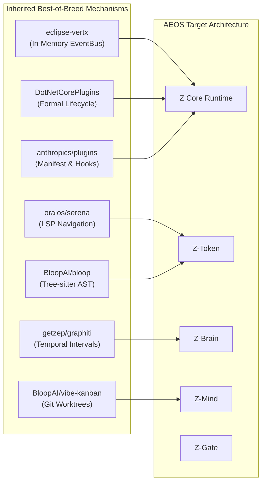

# 02. Open-Source Technology & Architecture Benchmark

## 1. Executive Benchmarking Methodology

This benchmark evaluates 14 prominent open-source projects across four functional domains and five agent orchestration frameworks. Rather than superficial README reviews, each project is dissected based on its source architecture, package structure, runtime mechanics, trade-offs, and empirical suitability for the **Agent Engineering Operating System (AEOS)**.

---

## 2. Group A: Agent Workflow & Skill Systems

### 2.1 `obra/superpowers` (Jesse Vincent)
- **Target URL**: https://github.com/obra/superpowers
- **1. Problem Solved**: Eliminates undisciplined AI coding habits (jumping into editing without specifications, skipping tests, or creating unmaintainable diffs).
- **2. Concrete Architecture**: Composable skills framework for Claude Code. Operates via declarative markdown directives (`SKILL.md`) structured into a disciplined multi-step lifecycle: Clarification $\rightarrow$ Specification $\rightarrow$ Implementation Plan (TDD) $\rightarrow$ Subagent Delegation $\rightarrow$ Review Loop.
- **3. Proven Strengths**:
  - Enforces Test-Driven Development (TDD) as a mandatory gate before code modification.
  - Subagent-driven development: delegates distinct subtasks to separate subagent contexts to prevent single-context bloat.
  - High developer trust through structured interactive interviews before executing destructive operations.
- **4. Limitations & Trade-Offs**:
  - Relies entirely on prompt engineering and agent compliance; lacks mechanical enforcement via hard process sandboxing.
  - Generates significant conversational turns and token overhead for trivial tasks.
- **5. Components to Adopt**:
  - Subagent task dispatching and isolated review loops.
  - Two-stage specification refinement protocol.
- **6. What NOT to Copy**:
  - Monolithic prompt injection that floods every prompt turn with exhaustive instructions.
- **7. Application to Z-Plugin**:
  - Integrate into `z-mind`'s plan generator and multi-agent coordination (`z-teamwork`), replacing static plans with interactive checkpoint gates.
- **8. Integration & Maintenance Cost**: **Low** (Markdown workflow patterns, zero binary dependencies).

### 2.2 `anthropics/claude-plugins-official` & `anthropics/skills`
- **Target URLs**: https://github.com/anthropics/claude-plugins-official | https://github.com/anthropics/skills
- **1. Problem Solved**: Standardizes plugin and skill packaging, distribution, discovery, and lifecycle hook execution for Anthropic's agent ecosystem.
- **2. Concrete Architecture**: Strict directory layout convention: `.claude-plugin/plugin.json` (metadata & userConfig), `hooks/hooks.json` (lifecycle triggers: `SessionStart`, `UserPromptSubmit`, `PreToolUse`, `PostToolUse`, `SessionEnd`), `.mcp.json` (stdio MCP tool configs), and `skills/*/SKILL.md`. Uses `${CLAUDE_PLUGIN_ROOT}` for portable path resolution.
- **3. Proven Strengths**:
  - Non-invasive hook execution: hooks run as external commands, preventing harness crashes.
  - Granular event-driven lifecycle: allows interception before tools run (`PreToolUse`) and context injection at start (`SessionStart`).
  - Standardized declarative packaging with zero custom build scripts required for discovery.
- **4. Limitations & Trade-Offs**:
  - Stdio process invocation per hook call incurs process spawn overhead on Windows (50–100ms per trigger).
  - No built-in inter-plugin communication or shared state management.
- **5. Components to Adopt**:
  - Portable root variable abstraction (`${PLUGIN_ROOT}`).
  - Standardized hook event schema and manifest format.
- **6. What NOT to Copy**:
  - Lack of a central runtime daemon or service registry, which forced plugins into ad-hoc filesystem coupling.
- **7. Application to Z-Plugin**:
  - Upgrade `z-plugin` manifest schema to `manifest.v2.json`, ensuring full bidirectional compatibility with Anthropic standards while adding typed capability declarations.
- **8. Integration & Maintenance Cost**: **Low** (Format alignment, configuration mapping).

---

## 3. Group B: Semantic Code Intelligence

### 3.1 `oraios/serena`
- **Target URL**: https://github.com/oraios/serena
- **1. Problem Solved**: Replaces blunt string grep and probabilistic vector RAG with precise, compiler-grade symbol navigation and manipulation.
- **2. Concrete Architecture**: MCP server acting as a bridge between LLM coding agents and Language Server Protocol (LSP) servers (such as `gopls`, `pyright`, `rust-analyzer`, `omnisharp`/`csharp-ls`). Maintains active LSP sessions over stdio/JSON-RPC, querying symbol tables, definition locations, reference trees, and type hierarchies.
- **3. Proven Strengths**:
  - 100% precision on symbol resolution (classes, interfaces, methods, references) across 30+ languages.
  - Surgical code manipulations (`replace_symbol_body`, `rename_symbol`) without breaking syntax.
  - Zero token waste on scanning irrelevant files.
- **4. Limitations & Trade-Offs**:
  - Heavy dependency on host language tooling: requires compilers and LSP binaries pre-installed on the developer machine.
  - High cold-start time while language servers index massive projects (e.g., initial OmniSharp solution loading).
- **5. Components to Adopt**:
  - Symbol-level navigation API (`find_referencing_symbols`, `get_symbol_body`).
  - Decoupled MCP tool interface for structural code querying.
- **6. What NOT to Copy**:
  - Requiring language servers for every lightweight file inspection.
- **7. Application to Z-Plugin**:
  - Complement `z-token`'s `outline` tool with an optional LSP connector for C#, TypeScript, and Python, falling back to fast local AST/heuristics when LSPs are absent.
- **8. Integration & Maintenance Cost**: **Medium** (Node.js JSON-RPC LSP client implementation).

### 3.2 `BloopAI/bloop` & `BloopAI/vibe-kanban`
- **Target URLs**: https://github.com/BloopAI/bloop | https://github.com/BloopAI/vibe-kanban
- **1. Problem Solved**: `bloop` solves large-scale semantic code search across multi-repo codebases; `vibe-kanban` solves file collision and context chaos in multi-agent asynchronous workflows.
- **2. Concrete Architecture**:
  - `bloop`: Rust-native engine using **Tantivy** for high-speed regex/exact indexing, **Tree-sitter** for precise grammar parsing and go-to-definition, and **Qdrant** for vector search.
  - `vibe-kanban`: Spawns autonomous AI agents into dedicated, isolated **Git worktrees**, allowing parallel execution without file locks or git branch pollution.
- **3. Proven Strengths**:
  - Tree-sitter provides sub-millisecond, syntax-aware AST extraction without external compilers.
  - Git worktrees guarantee 100% collision-free workspace isolation for concurrent agents.
- **4. Limitations & Trade-Offs**:
  - `bloop` requires a heavy Rust build pipeline and runs external daemon processes (Tantivy + Qdrant), which contradicts `z-plugin`'s lightweight local-first requirement.
- **5. Components to Adopt**:
  - **Tree-sitter grammar parsing** (via `web-tree-sitter` WebAssembly in Node.js).
  - **Git worktree isolation** for multi-agent teams in `z-mind` / `z-teamwork`.
- **6. What NOT to Copy**:
  - Bloated Qdrant daemon infrastructure and heavy native C++/Rust compilation toolchains.
- **7. Application to Z-Plugin**:
  - Upgrade `z-token`'s `scan.mjs` to use `web-tree-sitter` Wasm for C#, TypeScript, Python, and Go.
  - Update `z-mind`'s subagent coordinator to allocate temporary Git worktrees (`git worktree add`) for subagents.
- **8. Integration & Maintenance Cost**: **Medium** (Wasm bindings for Tree-sitter, Git worktree lifecycle management).

---

## 4. Group C: Persistent Memory & Knowledge Engines

### 4.1 `thedotmack/claude-mem`
- **Target URL**: https://github.com/thedotmack/claude-mem
- **1. Problem Solved**: Resolves "session amnesia" by automatically extracting and retaining developer decisions, bug fixes, and architectural choices across CLI sessions.
- **2. Concrete Architecture**: Background worker hooks intercept `PostToolUse` and `SessionEnd` events. Raw tool inputs and diffs are compressed into structured 500-token observations. Observations are indexed locally in SQLite via `fts5` and injected dynamically into new sessions on `SessionStart`.
- **3. Proven Strengths**:
  - Frictionless background capture: requires zero manual prompt prompting from the developer.
  - Direct integration with native Claude Code hooks.
  - Low-latency local SQLite FTS5 keyword indexing.
- **4. Limitations & Trade-Offs**:
  - Dependent on an external runtime (Bun worker daemon) and secondary Python `uv` toolchain for vector search.
  - Flat observation logging without contradiction resolution or entity relationship mapping.
- **5. Components to Adopt**:
  - Background `PostToolUse` observation harvesting trigger.
  - Session startup context injection protocol.
- **6. What NOT to Copy**:
  - Requiring multiple disparate runtimes (Bun + Python uv).
- **7. Application to Z-Plugin**:
  - Refactor `z-brain`'s session observer into a native Node.js 22 background worker that automatically aggregates git diffs and test results into `session_observations`.
- **8. Integration & Maintenance Cost**: **Low-to-Medium** (Native Node.js background pipeline).

### 4.2 `getzep/graphiti` & `mem0ai/mem0`
- **Target URLs**: https://github.com/getzep/graphiti | https://github.com/mem0ai/mem0
- **1. Problem Solved**: Solves the failure of static vector embeddings to track evolving facts, entity relationships, and temporal changes over time.
- **2. Concrete Architecture**: 
  - `graphiti`: Temporally-aware Knowledge Graph engine. Facts are stored as structured nodes and edges with **validity intervals** ($t_{\text{valid\_from}}, t_{\text{valid\_to}}$). When a fact is invalidated by a subsequent action, its edge is closed rather than deleted.
  - `mem0`: Multi-layer memory architecture separating user preferences, session history, and domain facts, using hybrid BM25 + Vector + Graph search.
- **3. Proven Strengths**:
  - Bi-temporal modeling enables historical reasoning: *"What was the architecture before migration vs now?"*
  - Eliminates contradictory memories through deterministic edge invalidation.
- **4. Limitations & Trade-Offs**:
  - High computational overhead for graph extraction using LLM prompts on every turn.
  - Complex graph database requirements (Neo4j or specialized graph vector engines).
- **5. Components to Adopt**:
  - Temporal validity windows ($t_{\text{start}}, t_{\text{end}}$) on knowledge atoms.
  - Entity-relationship tuples (`(EntityA) -[RELATION]-> (EntityB)`) mapped inside SQLite relational tables.
- **6. What NOT to Copy**:
  - Requiring heavy cloud graph databases; excessive LLM extraction passes on minor operations.
- **7. Application to Z-Plugin**:
  - Upgrade `z-brain`'s schema to support temporal intervals and entity edges directly within SQLite relational tables (`entity_nodes`, `entity_edges`), enabling graph traversal via recursive Common Table Expressions (CTEs).
- **8. Integration & Maintenance Cost**: **Medium** (Relational graph schema design in SQLite).

---

## 5. Group D: Plugin Runtime & Extension Architecture

### 5.1 `natemcmaster/DotNetCorePlugins` & `weikio/PluginFramework`
- **Target URLs**: https://github.com/natemcmaster/DotNetCorePlugins | https://github.com/weikio/PluginFramework
- **1. Problem Solved**: Solves assembly isolation, dynamic code loading, dependency conflict ("DLL Hell"), and safe unloading in modular software.
- **2. Concrete Architecture**: Uses .NET `AssemblyLoadContext` (ALC) sandboxes to isolate each plugin's dependencies. Pinned **shared contracts** (interfaces) live in the host context, allowing the host to cast and execute plugin types safely while keeping implementation dependencies isolated.
- **3. Proven Strengths**:
  - True runtime isolation: Plugin A can run dependency v1.0 while Plugin B runs v2.0 without collision.
  - Formal contract-first boundary: communication occurs strictly through strongly typed interfaces.
  - Hot-reloading capabilities when `isUnloadable: true` is configured.
- **4. Limitations & Trade-Offs**:
  - High GC complexity: lingering static references or unhandled event subscriptions permanently leak memory and prevent ALC unloading.
- **5. Components to Adopt**:
  - **Shared Contract Boundary**: Plugins never expose concrete implementation classes; they register capabilities against typed contracts.
  - **9-State Lifecycle Machine**: DISCOVER $\rightarrow$ VALIDATE $\rightarrow$ RESOLVE $\rightarrow$ LOAD $\rightarrow$ INITIALIZE $\rightarrow$ ACTIVATE $\rightarrow$ EXECUTE $\rightarrow$ DEACTIVATE $\rightarrow$ DISPOSE.
- **6. What NOT to Copy**:
  - Over-engineered unloadable assembly mechanics for lightweight Node.js environments.
- **7. Application to Z-Plugin**:
  - Establish the formal Plugin Contract Interface (`IZPlugin`, `IZCapability`) for the Z Core Runtime.
- **8. Integration & Maintenance Cost**: **Low-to-Medium** (Architectural discipline and manifest schemas).

### 5.2 `eclipse-vertx/vert.x`
- **Target URL**: https://github.com/eclipse-vertx/vert.x
- **1. Problem Solved**: Enables massive scalability and decoupled asynchronous communication between heterogeneous, polyglot software modules.
- **2. Concrete Architecture**: Event-driven reactive micro-kernel. Modules ("Verticles") communicate exclusively over a distributed or in-memory **EventBus** using asynchronous point-to-point, request-reply, and publish-subscribe addressing. Verticles maintain zero direct references to each other.
- **3. Proven Strengths**:
  - Absolute decoupling: sender and receiver know nothing of each other except the message address and JSON schema.
  - High throughput and low memory footprint (non-blocking event loop).
  - Graceful degradation: if a subscriber is offline, events are buffered or failed cleanly without crashing the sender.
- **4. Limitations & Trade-Offs**:
  - Tracing asynchronous event flows requires robust correlation IDs and observability tooling.
- **5. Components to Adopt**:
  - **In-Memory Asynchronous EventBus**: Decouples `z-gate`, `z-brain`, `z-craft`, and `z-mind` completely.
  - Request-Reply IPC over EventBus addresses (e.g., `zbrain.query`, `zgate.review`).
- **6. What NOT to Copy**:
  - Distributed cluster management (Hazelcast/ZooKeeper) which is irrelevant for a local CLI agent.
- **7. Application to Z-Plugin**:
  - Implement a 250-line native Node.js EventBus in Z Core Runtime, immediately eliminating all hardcoded relative filesystem imports (`../../../z-brain`).
- **8. Integration & Maintenance Cost**: **Low** (Native Node.js EventEmitter / AsyncQueue).

---

## 6. Synthesis: Architectural Integration Matrix

The following matrix identifies exactly what AEOS inherits, integrates, or avoids from the benchmarked projects:

