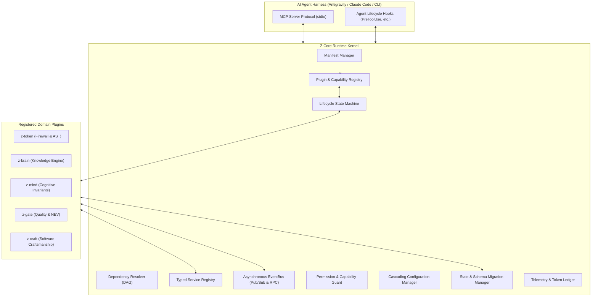
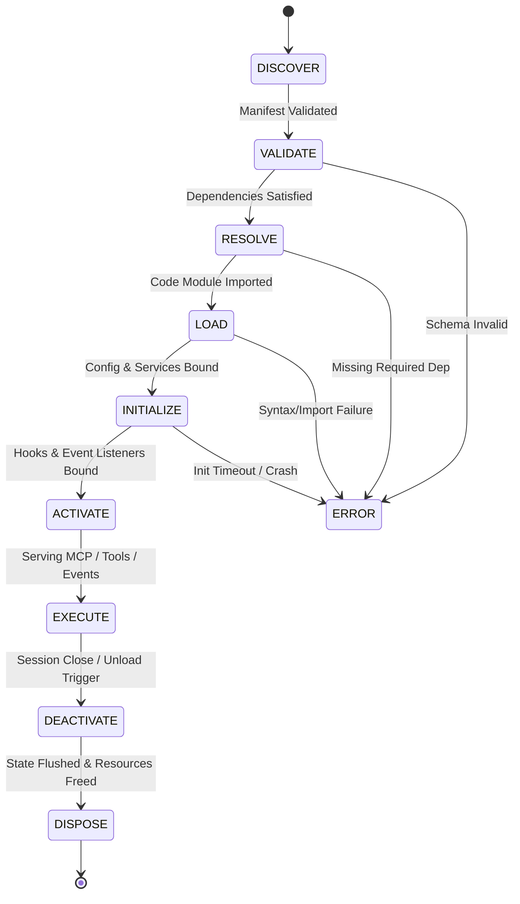

# 04. Z Core Runtime Technical Specification

## 1. Executive Purpose & Architectural Principles

The **Z Core Runtime** (`z-runtime`) is the central micro-kernel of the Agent Engineering Operating System (AEOS). It transitions the `z-plugin` ecosystem from disconnected script files into a coordinated, resilient runtime.

### Fundamental Runtime Principles
1. **Micro-Kernel Simplicity**: The runtime kernel contains zero business logic, zero domain rules, and zero prompt text. It is purely an execution substrate providing lifecycle, messaging, service lookup, and isolation.
2. **Zero-Setup Local-First Footprint**: Written in standard, high-performance Node.js 22 ES modules. Startup latency must remain under 20ms, and total resident memory overhead under 15MB RSS.
3. **Decoupled Asynchronous Inter-Plugin Messaging**: No plugin may directly import concrete internal scripts from a sibling plugin via filesystem paths. All communication flows through the in-memory EventBus or typed Service Contracts.
4. **Resilient Failure Boundaries**: A failure or crash in one plugin (e.g., an AST parsing exception in `z-craft`) must never crash the host agent, the runtime kernel, or sibling plugins.

---

## 2. Core Architecture Topology



---

## 3. Subsystem Specifications

### 3.1 Plugin Registry & Manifest Manager
The **Plugin Registry** is the single source of truth for all discovered, validated, and active plugins.
- **Discovery Paths**:
  1. Built-in core directory: `${AEOS_ROOT}/plugins/*`
  2. User configuration directory: `~/.zcode/plugins/*` or `~/.gemini/config/plugins/*`
  3. Workspace local directory: `${WORKSPACE}/.agent/plugins/*`
- **Manifest Parsing**: Reads and validates `z-plugin.manifest.json` against the standard JSON Schema v2.
- **Capability Registration**: Indexes plugins by the unique capabilities they provide (e.g., `capability:knowledge-query`, `capability:ast-outline`, `capability:nev-review`).

### 3.2 Dependency Resolver (DAG)
Resolves inter-plugin dependencies using a directed acyclic graph (DAG):
- **Resolution Strategy**: Computes topological sorting across plugins based on declared `dependencies` and semver constraints.
- **Cycle Detection**: Executes Tarjan's strongly connected components algorithm during the `RESOLVE` state. Any circular dependency triggers a hard validation error before code loading.
- **Optional Degradation**: If an optional dependency is missing (e.g., `z-gate` declaring optional dependency on `z-brain`), the resolver marks the capability as unavailable without halting the boot sequence.

### 3.3 9-State Deterministic Lifecycle Machine
Every plugin transitions through an explicit, auditable 9-state lifecycle:



#### Lifecycle State Definitions:
1. **DISCOVER**: Directory scanner identifies plugin folder and reads manifest.
2. **VALIDATE**: Manifest schema, permissions, and engine requirements are verified.
3. **RESOLVE**: Dependency DAG is evaluated; capability matching is confirmed.
4. **LOAD**: Dynamic ES module import (`import()`) occurs into a sandboxed execution wrapper.
5. **INITIALIZE**: Plugin's `initialize(context)` method is executed. Receives configuration, logger, and service binder.
6. **ACTIVATE**: Plugin registers its MCP tools, lifecycle hooks, and EventBus listeners.
7. **EXECUTE**: Plugin is actively processing tool invocations and event subscriptions.
8. **DEACTIVATE**: Ceases accepting new requests; active operations are drained (grace period: 3,000ms).
9. **DISPOSE**: Closes database handles, releases file locks, unregisters EventBus topics, and clears references.

### 3.4 Service Registry & Typed Contracts
Provides dynamic dependency injection and lookup for high-performance direct method calls between plugins without path-based imports:
```typescript
interface IServiceRegistry {
  register<T>(serviceId: string, instance: T, options?: ServiceOptions): void;
  get<T>(serviceId: string): T | null;
  getRequired<T>(serviceId: string): T;
  has(serviceId: string): boolean;
}
```
- **Example Usage**: `z-gate` queries `z-brain` via the service registry:
  ```javascript
  const knowledgeService = context.services.get('IKnowledgeService');
  if (knowledgeService) {
    const gotchas = await knowledgeService.lookupGotchasByFiles(touchedFiles);
  }
  ```

### 3.5 In-Memory Asynchronous EventBus
A lightweight, high-performance publish/subscribe and request-reply event broker built on native Node.js:
- **Addressing Convention**: Dot-separated namespace topics (e.g., `code.modified`, `review.completed`, `memory.harvested`).
- **Delivery Guarantees**:
  - In-process non-blocking asynchronous dispatch (`setImmediate`).
  - Wildcard subscriptions supported (`review.*`).
  - Error isolation: An unhandled exception in an event listener is captured by the kernel error boundary and never bubbles to the event publisher.
- **Request-Reply Pattern**:
  ```javascript
  const result = await context.eventBus.request('zbrain.query', { query: 'SQL lock timeout' }, { timeoutMs: 1500 });
  ```

### 3.6 Permission & Capability Manager
Enforces capability-based security boundaries. Even though plugins run in-process, access to sensitive operations must be declared in the manifest:
- **Permission Scopes**:
  - `fs:read` / `fs:write`: Paths restricted to `${WORKSPACE}` or `${PLUGIN_DATA}`.
  - `process:exec`: Whitelisted binary commands (e.g., `git`, `dotnet`, `npm`).
  - `net:outbound`: Whitelisted hostnames or ports (default: blocked for local-first autonomy).
  - `memory:admin`: Permission to drop or compact the shared SQLite knowledge base.

### 3.7 State Ownership & Schema Migration Manager
- **Ownership Invariant**: A plugin owns its private SQLite tables or storage files. No external plugin may execute direct SQL against another plugin's private tables.
- **Migration Engine**: The state manager tracks schema versions (`PRAGMA user_version`) and runs incremental migration scripts on startup (`migrations/001_init.sql`, `002_add_vector.sql`) wrapped in atomic transactions.

### 3.8 Cascading Configuration Manager
Merges configuration settings following a deterministic hierarchical precedence:
1. **Transient CLI Flags**: Passed during invocation (e.g., `--strict-tokens`).
2. **Workspace Configuration**: Located at `${WORKSPACE}/.agent/config.json`.
3. **User Global Configuration**: Located at `~/.zcode/config.json` or `~/.gemini/config/config.json`.
4. **Plugin Default Configuration**: Declared in the plugin's `z-plugin.manifest.json`.

### 3.9 Observability & Token Telemetry
- **Structured JSON Logging**: Uniform logging format with timestamp, level, plugin ID, correlation ID, and message.
- **Context & Token Ledger**: Maintains rolling session statistics on blocked tokens, saved characters, tool latency, and memory recall hits. Exposes metrics via the MCP Resource `ui://z-runtime/dashboard.html`.

---

## 4. Fault Isolation Strategy

To satisfy the local-first requirement while maintaining system stability:
- **Logical Boundary Isolation (Default)**: Plugins run within the same Node.js process but wrapped in `try/catch` error boundaries and async timeout wrappers. This maintains zero IPC serialization overhead and sub-millisecond call speeds.
- **Worker Thread Isolation (Optional for Heavy Compute)**: Plugins performing intensive AST parsing or ONNX vector embeddings run inside a background `node:worker_threads` pool to prevent event loop lag in the host agent.
- **Crash Recovery**: If a plugin fails during execution, the Lifecycle Manager transitions it to the `ERROR` state, triggers cleanup, and allows the remaining plugins to function unimpeded.
