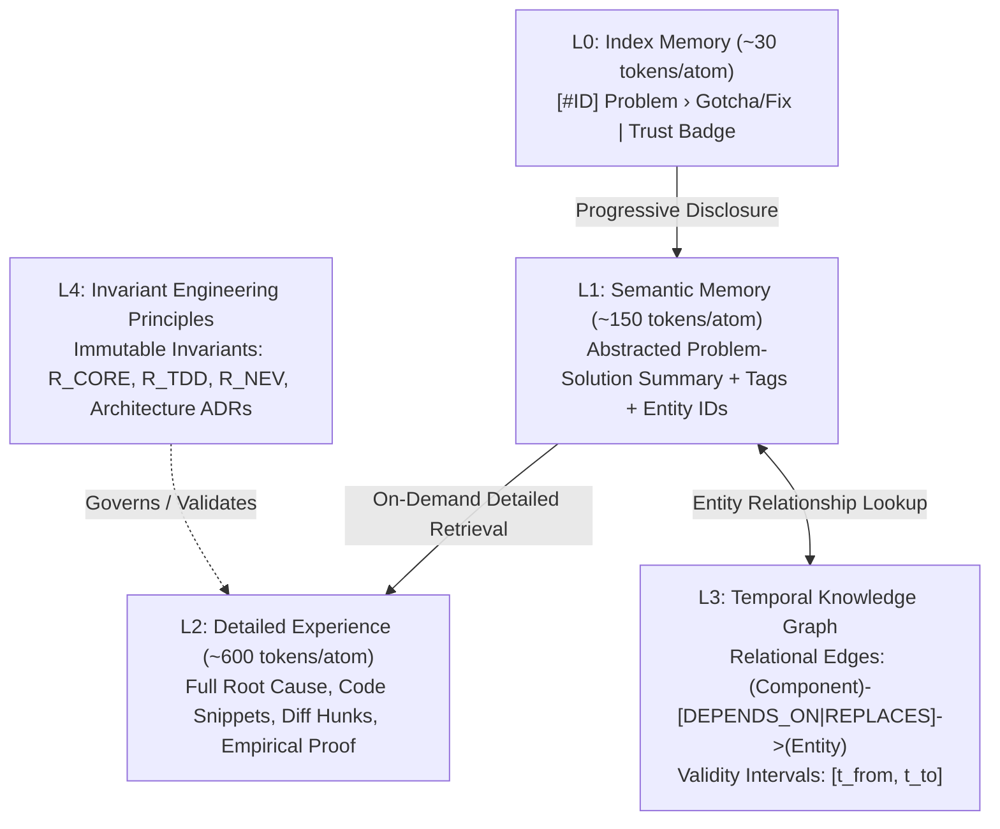

# 06. Z-Brain Evolution: Enterprise Knowledge Engine Specification

## 1. Architectural Vision

`z-brain` evolves from a flat, keyword-indexed SQLite database into a **5-Tier Hybrid Episodic & Temporal Knowledge Engine**. 

The upgraded architecture retains its **local-first, zero-external-server, and CPU-efficient** foundation while resolving the critical shortcomings identified in the audit:
1. Replaces primitive 45-character prefix deduplication with **local ONNX dense vector embeddings**.
2. Merges keyword and semantic signals via **Reciprocal Rank Fusion (RRF)**.
3. Implements **bi-temporal validity intervals** ($t_{\text{valid\_from}}, t_{\text{valid\_to}}$) to model evolving architectures and prevent contradictory or obsolete workarounds from corrupting agent context.

---

## 2. The 5-Tier Memory Hierarchy

To balance context token consumption against semantic depth, memory is organized into five progressive disclosure tiers:



### Tier Descriptions & Token Budgets
- **L0 — Index Memory (~30 tokens/atom)**: Ultra-compact index returned during initial context sweep (`zbrain_fetch`). Allows the agent to review 20 candidate memories in under 600 tokens.
- **L1 — Semantic Memory (~150 tokens/atom)**: Dense semantic summary, normalized keywords, and entity associations. Used by the Cognitive Router to evaluate relevance.
- **L2 — Detailed Experience (~600 tokens/atom)**: Full episodic record containing exact root cause, code patch diffs, compiler error strings, and Level 3+ empirical verification logs. Loaded on-demand via `zbrain_view(id)`.
- **L3 — Temporal Knowledge Graph**: Structured entity nodes and directed edges stored in SQLite relational tables. Captures relationships between files, architectural layers, and technologies across time.
- **L4 — Engineering Principles**: Invariant rules and accepted Architecture Decision Records (ADRs). These serve as ground truth and cannot be overridden by casual observations.

---

## 3. Memory Classification Taxonomy

Every memory atom is classified into one of five structural categories:
1. **Episodic**: Records specific events, bug investigations, and test failures (e.g., *"SQL timeout occurred during batch 500 on VJetInventory"*).
2. **Semantic**: Curated domain facts and conventions (e.g., *"Orders with status 'Approved' require manager sign-off before status mutation"*).
3. **Procedural**: Step-by-step technical workflows (e.g., *"How to safely publish single-file framework-dependent desktop releases without locking DLLs"*).
4. **Architectural**: High-impact design decisions, layer boundaries, and interface contracts (e.g., *"Ban BindingSource across all WinForms modules; enforce BaseForm RunAfterShown"*).
5. **Project-Scoped**: Team conventions, branch naming, local connection strings, and workspace-specific quirks.

---

## 4. The 11-Stage Processing Pipeline

Data flows through an 11-stage automated pipeline from initial tool execution to consolidated memory:

```mermaid
flowchart LR
    Obs[1. Observation] --> Ext[2. Extraction]
    Ext --> Norm[3. Normalization]
    Norm --> Class[4. Classification]
    Class --> Dedup[5. Deduplication]
    Dedup --> Val[6. Validation]
    Val --> Store[7. Storage]
    Store --> Idx[8. Indexing]
    Idx --> Ret[9. Retrieval]
    Ret --> Rerank[10. Reranking]
    Rerank --> Cons[11. Consolidation]
```



### Stage Specifications:
1. **Observation**: Background hook (`PostToolUse` / `SessionEnd`) intercepts git diffs, test assertion failures, and terminal error logs.
2. **Extraction**: Condenses noisy outputs into an atomic tuple: `problem | root_cause | solution_patch`.
3. **Normalization**: Strips transient timestamps, random GUIDs, and local user paths; standardizes language tokens (`c#` $\rightarrow$ `csharp`).
4. **Classification**: Assigns memory category (Episodic, Semantic, Procedural, Architectural) and tags.
5. **Deduplication**: Computes 384-dimensional dense vector embedding. If cosine similarity with an existing atom $> 0.88$, merges evidence rather than inserting a duplicate.
6. **Validation**: Verifies empirical proof. If backed by passing test assertion counts or compiler exit code 0, sets `trust_level = 'verified_fact'`; otherwise sets `trust_level = 'observation'`.
7. **Storage**: Commits atom to SQLite `knowledge_atoms` table in WAL mode with transactional atomicity.
8. **Indexing**: Synchronizes SQLite `knowledge_fts` (FTS5) and writes dense embedding to SQLite `vector_index` blob table.
9. **Retrieval**: Executes parallel BM25 keyword matching and Vector KNN search.
10. **Reranking**: Merges candidate sets using Reciprocal Rank Fusion (RRF) with temporal decay weighting.
11. **Consolidation**: Background cron job detects contradictory or outdated atoms, closing their validity intervals ($t_{\text{valid\_to}} = \text{now}$) when a superseding pattern is proven.

---

## 5. Local Hybrid Retrieval Engine (BM25 + Local ONNX Vector)

To eliminate cloud API dependencies and maintain zero GPU requirements, `z-brain` runs quantized embeddings locally using ONNX Runtime on CPU.

### 5.1 Embedding Model Specification
- **Model**: `bge-small-en-v1.5` (quantized INT8 ONNX format).
- **Footprint**: 32MB disk size; 384 vector dimensions.
- **Inference Latency**: 12–18ms per sentence on a standard x64/ARM64 CPU core.
- **Zero-Setup Runtime**: Executed via `onnxruntime-node` or WebAssembly ONNX runner with zero Python dependencies.

### 5.2 Reciprocal Rank Fusion (RRF) Algorithm
BM25 and Vector Search produce scores on different scales. RRF unifies them robustly without manual weight tuning:

$$RRF(d) = \frac{w_{\text{bm25}}}{k + \text{rank}_{\text{bm25}}(d)} + \frac{w_{\text{vec}}}{k + \text{rank}_{\text{vec}}(d)}$$

Where:
- $k = 60$ (standard smoothing constant).
- $w_{\text{bm25}} = 0.45$ (keyword precision weight).
- $w_{\text{vec}} = 0.55$ (semantic conceptual weight).

```javascript
export function reciprocalRankFusion(bm25Results, vectorResults, k = 60) {
  const scores = new Map();

  bm25Results.forEach((doc, rank) => {
    const score = 0.45 / (k + rank + 1);
    scores.set(doc.id, { doc, score: (scores.get(doc.id)?.score || 0) + score });
  });

  vectorResults.forEach((doc, rank) => {
    const score = 0.55 / (k + rank + 1);
    scores.set(doc.id, { doc: doc.item, score: (scores.get(doc.id)?.score || 0) + score });
  });

  return Array.from(scores.values())
    .sort((a, b) => b.score - a.score)
    .map(entry => entry.doc);
}
```

---

## 6. Temporal Graph Schema & Contradiction Resolution

### 6.1 Relational Graph Schema in SQLite
Instead of requiring an external Neo4j daemon, `z-brain` models entity graphs directly inside SQLite:

```sql
-- Core Knowledge Atoms
CREATE TABLE IF NOT EXISTS knowledge_atoms (
  id INTEGER PRIMARY KEY AUTOINCREMENT,
  project_id TEXT NOT NULL DEFAULT 'global',
  category TEXT NOT NULL, -- episodic, semantic, procedural, architectural
  trust_level TEXT NOT NULL, -- observation, verified_fact, architectural_decision
  question TEXT NOT NULL,
  answer TEXT NOT NULL,
  gotcha_fix TEXT,
  tags TEXT NOT NULL DEFAULT '[]',
  confidence REAL DEFAULT 0.5,
  valid_from TEXT NOT NULL,
  valid_to TEXT, -- NULL indicates currently active/valid
  superseded_by INTEGER REFERENCES knowledge_atoms(id),
  created_at TEXT NOT NULL,
  updated_at TEXT NOT NULL
);

-- Entity Nodes (Files, Classes, Modules, Frameworks)
CREATE TABLE IF NOT EXISTS entity_nodes (
  id INTEGER PRIMARY KEY AUTOINCREMENT,
  name TEXT UNIQUE NOT NULL,
  type TEXT NOT NULL -- file, class, interface, library, pattern
);

-- Temporal Directed Edges
CREATE TABLE IF NOT EXISTS entity_edges (
  id INTEGER PRIMARY KEY AUTOINCREMENT,
  source_id INTEGER REFERENCES entity_nodes(id),
  target_id INTEGER REFERENCES entity_nodes(id),
  relation TEXT NOT NULL, -- DEPENDS_ON, REPLACES, VIOLATES, FIXES
  atom_id INTEGER REFERENCES knowledge_atoms(id),
  valid_from TEXT NOT NULL,
  valid_to TEXT
);

-- Vector Embeddings Storage (INT8 Quantized Flat Blobs)
CREATE TABLE IF NOT EXISTS atom_embeddings (
  atom_id INTEGER PRIMARY KEY REFERENCES knowledge_atoms(id),
  embedding BLOB NOT NULL -- 384 float32 / int8 bytes
);
```

### 6.2 Contradiction Resolution Engine
When a newly verified atom conflicts with an existing atom (detected via vector similarity $> 0.85$ but opposing outcomes in unit tests):
1. The engine checks `trust_level` and empirical proof.
2. If the new atom has higher proof (e.g., Level 3 test evidence vs an unverified observation), the existing atom is marked superseded:
   ```sql
   UPDATE knowledge_atoms 
   SET valid_to = CURRENT_TIMESTAMP, superseded_by = ? 
   WHERE id = ?;
   ```
3. A temporal edge `(NewAtom)-[SUPERSEDES]->(OldAtom)` is logged. Stale workarounds are naturally excluded from active queries while retaining an immutable audit trail.
