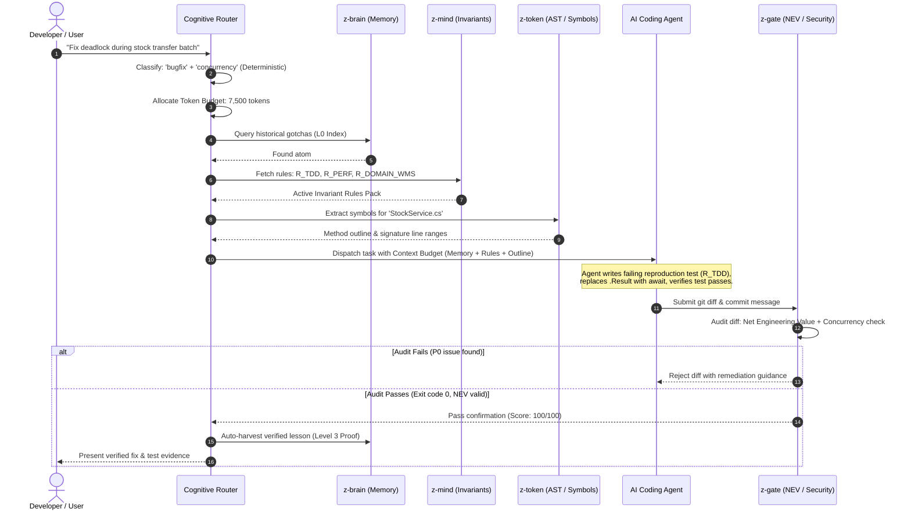
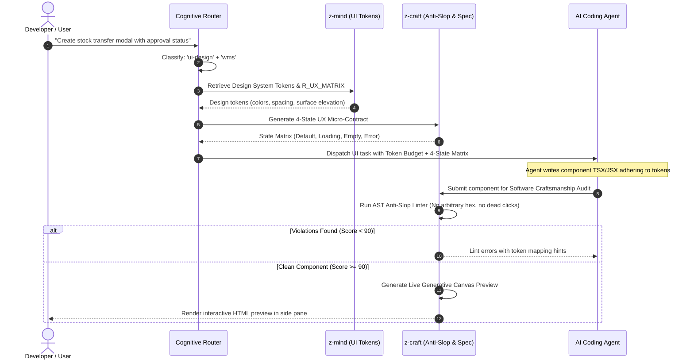

# 07. Cognitive Router & Token Budgeter Specification

## 1. Executive Purpose & Architectural Principles

The **Cognitive Router** is the orchestration brain of the Agent Engineering Operating System (AEOS). It intercepts user tasks, determines the minimal necessary toolset, allocates strict context token budgets, and executes coordinated multi-plugin workflows.

### Foundational Design Invariant
**Deterministic Routing First, LLM Routing Second.**
The router must never invoke an expensive, slow LLM call merely to decide whether a task is a bugfix, a refactor, or a UI implementation. Over 90% of engineering operations can be deterministically classified in $<1\text{ms}$ using fast lexical intent matching, file extension patterns, and active tool signatures. An LLM fallback is invoked only when intent ambiguity exceeds a calibrated threshold.

---

## 2. End-to-End Orchestration Workflows

The Cognitive Router coordinates plugins into choreographed multi-step execution graphs:

### 2.1 Workflow A: Code Bugfix Investigation & TDD Loop


### 2.2 Workflow B: UI Component Craftsmanship & Anti-Slop Loop


---

## 3. Subsystem Specifications

### 3.1 Two-Stage Intent & Task Classifier
1. **Stage 1: Deterministic Classifier ($<1\text{ms}$ latency)**:
   - Evaluates task prompt using regex rule-sets and file path markers:
     - `bugfix`: matches `fix|bug|error|exception|fail|crash|deadlock|timeout`
     - `refactor`: matches `refactor|clean\s*up|modularize|split|extract`
     - `ui-design`: matches `component|modal|form|css|tailwind|screen|view|ui`
     - `architecture`: matches `architecture|adr|design|layer|system`
   - Confidence score: $C_{\text{det}} \in [0.0, 1.0]$.
2. **Stage 2: Micro-LLM Escalation ($<200\text{ms}$)**:
   - Triggered only if $C_{\text{det}} < 0.60$ or if the prompt contains ambiguous conflicting goals. Calls a small local or fast model with a fixed 30-token completion schema.

### 3.2 Dynamic Context Token Budgeter
The primary cause of agent degradation in long sessions is unmanaged context bloat. The Token Budgeter allocates strict per-turn token ceilings:

```
Total Turn Context Allowance: 10,000 tokens (configurable)
├── Invariant Rules (z-mind):        1,000 tokens (10%)
├── Historical Memory (z-brain):     1,500 tokens (15%)
├── Code Symbols & Outline (z-token): 2,500 tokens (25%)
├── Conversation History & Trajectory: 4,000 tokens (40%)
└── Dynamic Reserve:                1,000 tokens (10%)
```

- **Enforcement Mechanics**:
  - If `z-brain` returns 4,000 tokens of raw memories, the budgeter truncates to L0 index representations (~30 tokens/atom), preserving only the top-scoring candidates.
  - If `z-token` outlines a 5,000-line file, the budgeter truncates private helper methods, retaining only public API signatures.

### 3.3 Dynamic Capability Matching & Plugin Selection
The router resolves required capabilities against the Plugin Registry:
- Input: `[capability:knowledge-query, capability:code-outline, capability:nev-review]`
- Resolution: Mapped to active plugins `[z-brain, z-token, z-gate]`.
- Missing Capabilities: If a capability is missing, the router selects an alternative provider or applies a documented fallback strategy without failing the task.

### 3.4 Human-in-the-Loop Approval Gates
Certain high-risk actions require explicit human confirmation before execution:
- **Destructive File Deletions**: Dropping more than 3 files or deleting $>200$ lines in production.
- **Git Branch Overwrites**: Force push or hard reset operations.
- **Database Schema Drops**: Dropping tables or modifying primary key constraints.
- **Protocol**: The router pauses execution, formats a structured markdown diff summary, and requests confirmation before proceeding.

---

## 4. Execution Engine & DAG Planner

Complex multi-step tasks are compiled into an in-memory execution DAG:

```typescript
export interface ITaskPlan {
  id: string;
  category: 'bugfix' | 'feature' | 'refactor' | 'ui' | 'architecture';
  tokenBudget: number;
  steps: ITaskStep[];
}

export interface ITaskStep {
  stepIndex: number;
  pluginId: string;
  action: string;
  input: Record<string, unknown>;
  dependsOn: number[]; // Step indices that must complete first
  requiresHumanApproval: boolean;
}
```

- **Parallel Execution**: Steps with zero mutual dependencies (e.g., querying `z-brain` for memory while simultaneously querying `z-token` for code outlines) run concurrently via `Promise.allSettled`.
- **Fault Recovery**: If an intermediate step fails, the router checks the step's fallback policy:
  - `ABORT`: Terminates workflow and returns error diagnostic.
  - `DEGRADE`: Skips non-critical step (e.g., historical memory unavailable) and continues with standard compiler/test feedback.
  - `RETRY`: Retries idempotent operations up to 2 times with exponential backoff.
