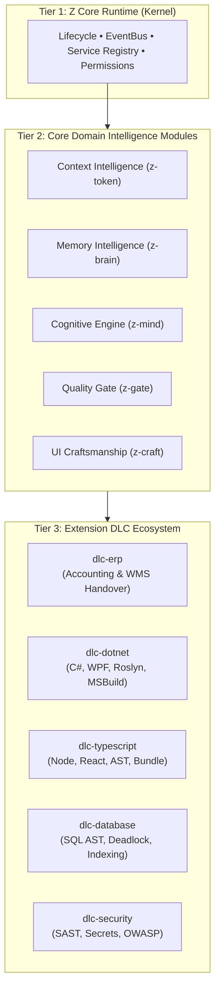

# 08. Core + DLC Architecture & Extension Ecosystem

## 1. Architectural Philosophy: The Three-Tier Model

The Agent Engineering Operating System (AEOS) adheres to a strict **Three-Tier Decomposition Model**:

1. **Tier 1: Z Core Runtime (Kernel)**: Universal, zero-business-logic foundation. Manages discovery, lifecycle state, event bus, and capability resolution.
2. **Tier 2: Core Domain Intelligence Modules**: General-purpose engineering capabilities applicable to any software project (Token firewall, Episodic memory, Cognitive rules, Quality gate, UI craftsmanship).
3. **Tier 3: Domain Extensions (DLC Packs)**: Specialized, highly vertical engineering packs (ERP accounting invariants, C# Roslyn linters, React state managers, SQL deadlock checkers).



---

## 2. Tier 1: The Core Kernel Specifications

The Core Kernel is distributed as a lightweight, zero-dependency engine.
- **Responsibilities**:
  - Validates manifests (`z-plugin.manifest.json`).
  - Resolves dependency DAGs.
  - Hosts the in-memory EventBus.
  - Manages SQLite schema migrations.
  - Enforces permission boundaries.
- **Anti-Bloat Guardrail**: Under no circumstances may kernel code contain domain terms such as "ERP", "React", "C#", "SQL", or "Tailwind".

---

## 3. Tier 2: Domain Intelligence Modules

Each domain module provides a general-purpose, language-agnostic capability:

| Module | Core Purpose | Provided Capabilities | Required Capabilities |
| :--- | :--- | :--- | :--- |
| **`z-token`** | Context budgeting, oversized read guard, loop breaker. | `capability:context-guard`<br/>`capability:token-budgeter` | None |
| **`z-brain`** | Multi-tier episodic and semantic memory engine. | `capability:knowledge-engine`<br/>`capability:session-observer` | `capability:token-budgeter` (optional) |
| **`z-mind`** | Cognitive workflow router and architecture invariants. | `capability:cognitive-router`<br/>`capability:rule-governor` | `capability:knowledge-engine`<br/>`capability:context-guard` |
| **`z-gate`** | Diff inspection, Net Engineering Value, code reuse. | `capability:quality-gate`<br/>`capability:nev-auditor` | `capability:knowledge-engine` (optional) |
| **`z-craft`** | Software craftsmanship, 4-state matrix, anti-slop. | `capability:ui-craftsmanship`<br/>`capability:canvas-preview` | `capability:quality-gate` (optional) |

---

## 4. Tier 3: Extension DLC Architecture

Extensions (Downloadable Capability Modules) package deep vertical expertise without bloating the core suite.

### 4.1 Structure of an Extension DLC
An extension DLC is an independent, versioned package adhering to the manifest v2 schema:

```
dlc-erp/
├── z-plugin.manifest.json
├── package.json
├── rules/
│   ├── finance-accounting.json      # R_DOMAIN_FIN rules
│   └── warehouse-handover.json      # R_DOMAIN_WMS rules
├── synonyms/
│   └── erp-dictionary.json          # Vietnamese/English ERP terms
├── linters/
│   └── decimal-precision.mjs        # Static check: double UnitPrice violation
└── tests/
    └── erp-rules.test.mjs
```

### 4.2 Manifest for `dlc-erp`
```json
{
  "id": "dlc-erp",
  "name": "ERP & Financial Engineering DLC",
  "version": "1.0.0",
  "kind": "extension-dlc",
  "extends": {
    "plugin": "z-mind",
    "slot": "domain-rules"
  },
  "dependencies": {
    "aeos": "^2.0.0",
    "z-mind": "^2.0.0",
    "z-gate": "^2.0.0"
  },
  "contributions": {
    "rules": [
      "./rules/finance-accounting.json",
      "./rules/warehouse-handover.json"
    ],
    "synonyms": "./synonyms/erp-dictionary.json",
    "gateChecks": [
      {
        "id": "ERP-DECIMAL",
        "name": "Decimal Currency Precision",
        "handler": "./linters/decimal-precision.mjs"
      }
    ]
  }
}
```

---

## 5. Catalog of Standard Extension DLCs

### 1. `dlc-erp` (Enterprise Resource Planning)
- **Domain Invariants**: Period lock enforcement, double-entry balance verification, 2-step warehouse transfer gate.
- **Diff Checks**: Detects `double` used for monetary amounts (requires `decimal`); flags `UPDATE Inventory` missing `UPDLOCK`.
- **Glossary**: Maps Vietnamese and English ERP business terminology (`tồn kho`, `phiếu xuất`, `công nợ`).

### 2. `dlc-dotnet` (C# / .NET Enterprise Desktop & WebAPI)
- **Language Invariants**: Modern C# syntax, mandatory `Async` suffix on Task methods, `Span<T>` in hot paths.
- **Desktop Governance**: STRICTLY NO `BindingSource`; enforces `BaseForm` / `XtraForm` `RunAfterShown` pattern.
- **Build Compression**: MSBuild log condensation (filters non-actionable warnings, aggregates duplicate errors).

### 3. `dlc-typescript` (TypeScript / Node.js / React)
- **Frontend Governance**: Centralized API clients, 4-state matrix enforcement, zero `window.location` inline redirects.
- **AST Anti-Slop**: Checks React JSX components for arbitrary hex colors and dead click handlers.
- **Bundle Optimization**: Detects un-treeshakable package imports (e.g., `import _ from 'lodash'`).

### 4. `dlc-database` (SQL & Database Engineering)
- **Concurrency & Locking**: Enforces parameterized queries only; flags missing transaction timeouts.
- **Schema Safety**: Blocks destructive table drops without rollback scripts; checks index existence on foreign keys.

### 5. `dlc-security` (Application Security & SAST)
- **Secret Scanning**: Regex and entropy detection for API keys, private certificates, and JWT tokens in diffs.
- **Injection Defense**: Static taint tracking for SQL injection, command execution, and path traversal vulnerabilities.

---

## 6. Packaging, Distribution & Dynamic Activation

- **Independent Versioning**: DLC packages follow Semantic Versioning (SemVer 2.0). A bugfix in `dlc-erp` does not require updating `z-runtime` or `z-token`.
- **Dynamic Slot Extension**: The Core Runtime provides extension slots (`domain-rules`, `gate-checkers`, `mcp-tools`). When a DLC is activated, the kernel registers its contributions without reloading the host agent.
- **Installation CLI**:
  ```bash
  # Install core runtime + base suite
  npx z-plugin install core

  # Add specialized DLCs
  npx z-plugin dlc add dlc-erp
  npx z-plugin dlc add dlc-dotnet
  ```
