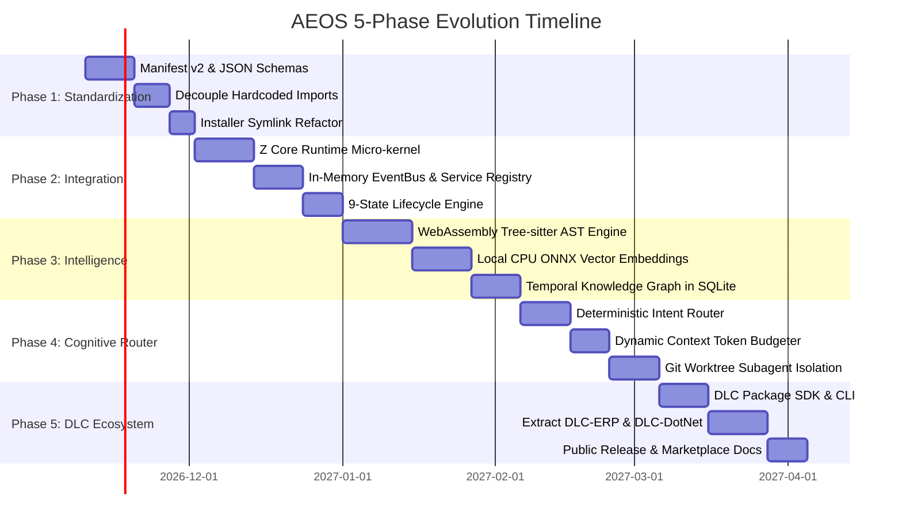

# 10. Practical Migration & Evolution Roadmap

## 1. Roadmap Overview & Phasing Principles

To evolve `z-plugin` into the **Agent Engineering Operating System (AEOS)** without interrupting current developer workflows, this roadmap spans five distinct, incrementally deployable phases.

### Core Migration Guardrail
**Zero Regression Invariant**: Existing MCP tool calls (`zbrain_fetch`, `read_symbol`, `zgate_review`, `zmind_rules`) must remain fully functional throughout all phases via backward-compatibility adapters.

---

## 2. Phase 1: Standardization & Hardening

- **Objective**: Standardize packaging, manifests, and file layouts; eradicate dangerous relative import paths (`../../../z-brain`); replace brittle directory mirroring in `install.ps1`.
- **Deliverables**:
  1. `schemas/manifest-v2.schema.json`: Formal JSON Schema for manifests.
  2. `z-plugin.manifest.json` authored for all 5 plugins.
  3. `install.ps1` updated with native symlink and in-place development mode.
  4. Path alias adapter shim (`src/compat/legacy-bridge.mjs`).
- **Impacted Files**:
  - `plugins/*/plugin.json` $\rightarrow$ `plugins/*/z-plugin.manifest.json`
  - `plugins/z-gate/scripts/lib/code-reviewer.mjs`
  - `plugins/z-craft/scripts/lib/spec-generator.mjs`
  - `install.ps1`
- **Dependencies**: None.
- **Acceptance Criteria**:
  - `npm test` and `bench/measure.mjs` pass 100% with exit code 0.
  - No plugin contains `import('../../../')` relative file paths.
- **Effort Estimate**: **22 Engineering Days**.
- **Risk**: Low (structural refactoring with test coverage).

---

## 3. Phase 2: Z Core Runtime & In-Memory Interop

- **Objective**: Implement the lightweight in-process Z Core Runtime kernel providing the 9-state lifecycle machine, EventBus, and typed Service Registry.
- **Deliverables**:
  1. `packages/z-runtime/`: The core micro-kernel module.
  2. `packages/z-runtime/src/event-bus.mjs`: High-speed in-memory pub/sub broker.
  3. `packages/z-runtime/src/service-registry.mjs`: Dynamic dependency injection container.
  4. `packages/z-runtime/src/lifecycle-machine.mjs`: Deterministic 9-state lifecycle runner.
- **Impacted Files**:
  - `package.json` (monorepo workspaces configured)
  - `plugins/z-gate/scripts/lib/code-reviewer.mjs` (rewired to `IKnowledgeService`)
  - `plugins/z-craft/scripts/lib/spec-generator.mjs` (rewired to `IHelperDiscoveryService`)
- **Dependencies**: Phase 1 completed.
- **Acceptance Criteria**:
  - Cold startup of runtime + 5 plugins completes in $<20\text{ms}$.
  - Plugins publish and receive events across EventBus without direct file references.
- **Effort Estimate**: **30 Engineering Days**.
- **Risk**: Medium (introducing central lifecycle management).

---

## 4. Phase 3: Semantic Intelligence & Memory Evolution

- **Objective**: Upgrade `z-token` with WebAssembly Tree-sitter AST parsing; upgrade `z-brain` with local CPU ONNX vector embeddings and temporal validity graphs.
- **Deliverables**:
  1. `plugins/z-token/src/ast/`: WebAssembly Tree-sitter parser integration for C#, TS, Python, Go.
  2. `plugins/z-brain/src/embeddings/`: Local ONNX runner for `bge-small-en-v1.5` (quantized INT8).
  3. `plugins/z-brain/src/search/hybrid-rrf.mjs`: Reciprocal Rank Fusion combining BM25 and vector search.
  4. `plugins/z-brain/src/db/temporal-graph.sql`: SQLite tables for entity nodes, edges, and validity intervals.
- **Impacted Files**:
  - `plugins/z-token/scripts/lib/scan.mjs`
  - `plugins/z-brain/scripts/lib/search.mjs`
  - `plugins/z-brain/scripts/lib/harvest.mjs`
  - `plugins/z-brain/scripts/lib/db.mjs`
- **Dependencies**: Phase 2 completed.
- **Acceptance Criteria**:
  - Symbol extraction recall increases from ~82% to $\ge 98.5\%$ on C# and TypeScript fixtures.
  - Semantic deduplication in `z-brain` detects non-verbatim duplicates with $>90\%$ accuracy.
  - Zero external Python or GPU dependencies; memory retrieval latency $<35\text{ms}$.
- **Effort Estimate**: **36 Engineering Days**.
- **Risk**: Medium-High (embedding model performance on low-end CPUs; mitigated by INT8 quantization).

---

## 5. Phase 4: Cognitive Router & Multi-Agent Orchestration

- **Objective**: Implement the deterministic-first Cognitive Router, Context Token Budgeter, and Git worktree subagent isolation.
- **Deliverables**:
  1. `packages/cognitive-router/`: Intent classification and DAG planner.
  2. `packages/cognitive-router/src/token-budgeter.mjs`: Context budgeting engine.
  3. `plugins/z-mind/src/worktree-manager.mjs`: Automated Git worktree provisioning for subagents.
- **Impacted Files**:
  - `plugins/z-mind/scripts/lib/plan-generator.mjs`
  - `plugins/z-mind/agents/architect.md`, `investigator.md`, `reviewer.md`
- **Dependencies**: Phase 2 & Phase 3 completed.
- **Acceptance Criteria**:
  - Over 90% of standard software engineering tasks deterministically classified in $<1\text{ms}$.
  - Total context consumption per turn remains strictly within allocated budget ceilings ($\pm 5\%$).
  - Concurrent subagents execute in parallel without Git lock conflicts or working tree pollution.
- **Effort Estimate**: **28 Engineering Days**.
- **Risk**: Medium (subagent coordination edge cases; mitigated by strict worktree teardown scripts).

---

## 6. Phase 5: DLC Ecosystem & Marketplace SDK

- **Objective**: Extract vertical domain logic into decoupled Extension DLCs (`dlc-erp`, `dlc-dotnet`, `dlc-typescript`) and publish the Extension Authoring SDK.
- **Deliverables**:
  1. `extensions/dlc-erp/`: Isolated ERP accounting and warehouse handover package.
  2. `extensions/dlc-dotnet/`: Isolated C# / WPF / MSBuild package.
  3. `extensions/dlc-typescript/`: Isolated Node / React / AST linter package.
  4. `tools/dlc-cli.mjs`: Developer CLI for authoring, testing, and installing DLCs.
  5. Complete developer documentation and contribution guides.
- **Impacted Files**:
  - `plugins/z-mind/rules/rules.json` (pruned to universal invariants)
  - `plugins/z-brain/scripts/lib/search.mjs` (ERP synonyms removed)
  - `plugins/z-gate/scripts/lib/code-reviewer.mjs` (ERP checks extracted)
- **Dependencies**: Phases 1–4 completed.
- **Acceptance Criteria**:
  - Core AEOS suite runs cleanly with zero ERP or language-specific code.
  - Installing `dlc-erp` seamlessly restores ERP invariants and synonym expansions via slot contributions.
- **Effort Estimate**: **30 Engineering Days**.
- **Risk**: Low (modular packaging).

---

## 7. Master Effort & Milestones Summary

| Phase | Title | Key Milestone | Duration | Target Completion |
| :--- | :--- | :--- | :--- | :--- |
| **Phase 1** | Standardization & Hardening | Manifest v2 & Zero Relative Imports | 22 Days | Month 1 |
| **Phase 2** | Z Core Runtime Micro-kernel | In-Memory EventBus & Service Registry | 30 Days | Month 2.5 |
| **Phase 3** | Semantic Intelligence & Memory | Tree-sitter Wasm & Local ONNX Hybrid | 36 Days | Month 4 |
| **Phase 4** | Cognitive Router & Multi-Agent | Deterministic Routing & Token Budgeting | 28 Days | Month 5.5 |
| **Phase 5** | DLC Ecosystem & SDK | Core + DLC Decomposed Release | 30 Days | Month 7 |
| **TOTAL** | **Full AEOS Evolution** | **Production-Ready v2.0 Platform** | **146 Days** | **~7 Months** |
