# 🔌 z-plugin (AEOS) — Agent Engineering Operating System

[](package.json)
[](https://nodejs.org)
[](https://github.com/kzxl/z-plugin)
[](https://modelcontextprotocol.io)
[](LICENSE)

**z-plugin** is the official monorepo providing the **Agent Engineering Operating System (AEOS)**: a high-performance, context-efficient, zero-overhead engineering infrastructure for **Google Antigravity 2.0**, **ZCode**, and **any AI Coding Agent** (Cursor, Claude Code, Windsurf, Cline, Roo Code, Aider, OpenHands).

Consolidating specialized core plugins, extension DLCs, a micro-kernel runtime, and a universal agent bridge under a single repository, `z-plugin` enables sub-10ms cross-process synchronization, adaptive token budgeting, episodic memory recall, and mechanical anti-slop code quality enforcement.

---

## 💥 Why AEOS? (Before vs. After)

| Challenge with Raw AI Coding Agents | With AEOS (`z-plugin`) Active | Impact |
| :--- | :--- | :---: |
| **Context Window Blowout:** Monolithic file reads and unbounded greps burn 40k–80k tokens per turn. | **AST Context Diet:** Prefix-sharded symbol cache extracts exact declarations and call paths. | **95% Token Savings** |
| **Invisible Dependencies:** Refactoring a function breaks 6 distant services without the agent noticing. | **Sub-2ms Call-Graph (`tracePath`):** Shortest invocation path traversal across interfaces and CQRS dispatchers. | **Zero Regression** |
| **Silent Security Sinks:** Agent injects unsanitized user parameters directly into raw SQL or process commands. | **Inter-Procedural Taint Engine:** Traces data flows down to sensitive sinks with path-sensitive branch guard detection. | **Taint Defense** |
| **AI Amnesia:** Repeating the same bugfix or gotcha across different chat sessions. | **Episodic Memory Engine (`z-brain`):** Embedded SQLite WAL with hybrid BM25 + Trigram semantic recall. | **Continuous Learning** |
| **AI Slop & Gradients:** Agent generates neon purple gradients, dead click handlers, and wrapper hell. | **Anti-Slop Linter (`z-craft` & `z-gate`):** AST enforcement of design tokens, 4-state UX matrix, and deletion test. | **Craftsmanship $\ge$ 90/100** |

---

## 📦 Shipped Modules & Extensions

| Component | Type | Version | Focus & Core Capabilities |
| :--- | :---: | :---: | :--- |
| [**`z-runtime`**](packages/z-runtime) | **Kernel** | `1.3.0` | **Core AEOS Micro-Kernel:** In-memory EventBus, Cross-Process Local IPC (`LocalIpcBridge`), <1ms Cognitive Router, Adaptive Dynamic Token Budgeter (3.5k-35k tokens), and <5ms Hot-Reload Manager. |
| [**`z-token`**](plugins/z-token) | **Plugin** | `1.3.0` | **Context Diet & Graphify Call-Graph:** Sub-2ms BFS shortest-path traversal (`tracePath`), blast radius, polymorphic interface stitching, CQRS/MediatR dispatching, type-aware chained instantiation, branch guard detection, code outline, lean builds. |
| [**`z-brain`**](plugins/z-brain) | **Plugin** | `1.3.0` | **Episodic Memory & Graphify Gotchas:** Embedded SQLite WAL, FTS5 BM25 + Trigram Semantic Search, relational gotchas edge lookup (`get_code_gotchas`), and Asynchronous Write Queue (`AsyncHarvestQueue`) with retry backoff. |
| [**`z-mind`**](plugins/z-mind) | **Plugin** | `1.3.0` | **Cognitive OS & 58 Invariants:** 58 canonical rules across 6 engineering pillars, 4-phase bugfix diagnosis, Net Engineering Value (NEV) refactor gate, composition root exemption & dynamic coupling risk score. |
| [**`z-gate`**](plugins/z-gate) | **Plugin** | `1.3.0` | **Asset Discovery, Taint Flow & NEV Gate:** Inter-procedural data-flow taint analysis (`trace_data_flow`), codebase helper discovery (`R_REUSE`), pre-commit diff audit against wrapper hell and LOC bloat, Git PreToolUse hook (`R_GIT`). |
| [**`z-craft`**](plugins/z-craft) | **Plugin** | `1.3.0` | **Software Craftsmanship & Topology Canvas:** Pure SVG force-directed physics canvas, domain community grouping (Leiden analog), Anti-Slop AST Linter (`R_ANTI_SLOP`), 4-state UX micro-contract generator, and vibe time-machine. |
| [**`dlc-erp`**](extensions/dlc-erp) | **DLC** | `1.3.0` | **ERP Domain Extension:** Financial precision audits (decimal vs double), WMS two-step handover validation, SQL UPDLOCK concurrency enforcement, and bilingual ERP terminology dictionary. |

---

## ⚡ Quick Start

### 0. 1-Second Setup for Cursor, Claude Code & Windsurf (`npx`)

No cloning required. Run directly from any existing codebase:

```bash
# Configure Cursor (.cursorrules & .cursor/mcp.json)
npx z-plugin init cursor

# Or configure Claude Code (CLAUDE.md & .claude_mcp.json)
npx z-plugin init claude

# Or configure all supported AI agents at once
npx z-plugin init all

# Run the live visual capability demo
npx z-plugin demo
```

### 1. One-Click Installation for Antigravity & ZCode

Link all core plugins simultaneously via zero-copy directory junctions:

```powershell
# From the z-plugin repository root
powershell -ExecutionPolicy Bypass -File install.ps1
```

### 2. Universal Agent Bridge (Cursor, Claude Code, Windsurf, Cline, Copilot)

Export standard Model Context Protocol (MCP) server configurations and engineering rules in 1 command:

```bash
# Export configs for all supported AI agents into current workspace
npm run agent:bridge -- export all

# Or export for a specific agent
npm run agent:bridge -- export cursor
npm run agent:bridge -- export claude
npm run agent:bridge -- export windsurf
npm run agent:bridge -- export cline
npm run agent:bridge -- export copilot
```

- **Cursor**: Generates `.cursorrules` and `.cursor/mcp.json`.
- **Claude Code**: Generates `CLAUDE.md` and `.claude_mcp.json`.
- **Windsurf**: Generates `.windsurfrules` and `.codeium_mcp.json`.
- **Copilot**: Generates `.github/copilot-instructions.md`.

### 3. Extension DLC Management

Scaffold, validate, and list modular domain extensions:

```bash
# List all active extension DLCs
npm run dlc -- list

# Scaffold a new extension DLC
npm run dlc -- create dlc-fintech

# Validate an existing extension DLC manifest
npm run dlc -- validate extensions/dlc-erp
```

---

## 🏛️ AEOS Architecture

```mermaid
flowchart TD
    subgraph Agents ["Supported AI Coding Agents"]
        AGY["🤖 Antigravity 2.0 / ZCode (Native)"]
        Cursor["💻 Cursor IDE (MCP + .cursorrules)"]
        Claude["⚡ Claude Code (MCP + CLAUDE.md)"]
        Windsurf["🌊 Windsurf (MCP + .windsurfrules)"]
        Cline["🔌 Cline / Roo Code (MCP)"]
        Aider["🛠️ Aider / OpenHands (CLI)"]
    end

    subgraph AEOSRuntime ["Z Core Runtime (packages/z-runtime)"]
        Router["🧭 Cognitive Router (<1ms Intent & Trigram Matcher)"]
        Budgeter["📊 Adaptive Token Budgeter (3.5k - 35k Scaling)"]
        DAG["📋 DAG Execution Planner (Parallel Partitioning)"]
        HotReload["🔥 HotReloadManager (<5ms In-Memory Cache Busting)"]
        IPC["📡 LocalIpcBridge (Atomic Stream ~/.zcode/ipc/)"]
    end

    subgraph CorePlugins ["Core Plugin Suite"]
        ZToken["🛡️ z-token (Context Firewall & AST Scan)"]
        ZBrain["🧠 z-brain (SQLite WAL + Hybrid Search + Async Queue)"]
        ZMind["⚖️ z-mind (58 Invariant Rules & Cognitive Plan)"]
        ZGate["🔍 z-gate (Asset Discovery & NEV Auditor)"]
        ZCraft["✨ z-craft (Anti-Slop Linter & 4-State Matrix)"]
    end

    subgraph Extensions ["Extension DLC Ecosystem"]
        DLC_ERP["📦 dlc-erp (WMS, Finance, Concurrency Locks)"]
        DLC_Custom["📦 Custom DLCs (dlc-*)"]
    end

    Agents <-->|"MCP JSON-RPC / CLI / IPC"| AEOSRuntime
    AEOSRuntime <--> CorePlugins
    CorePlugins <--> Extensions
```



---

## 🛠️ Core Capabilities

### 1. `z-runtime` (Kernel & Cognitive Router)
- **Deterministic Intent Routing:** Classifies intent (`bugfix`, `refactor`, `ui`, `review`, `architecture`, `feature`) in $<1\text{ms}$ using bilingual regular expressions and semantic trigram centroids.
- **Adaptive Token Budgeting:** Dynamically scales context allocation between 3,500 tokens (for simple typos) and 35,000 tokens (for monorepo refactoring), dynamically reallocating category weights (symbols vs history vs rules).
- **Cross-Process Local IPC:** Broadcasts atomic events across independent terminal sessions, Cursor, and Antigravity with sub-10ms delivery latency via `~/.zcode/ipc/event_stream.jsonl`.
- **Instant Hot-Reload:** Debounced file watcher (`fs.watch`) invalidates in-memory rule and synonym caches in $<5\text{ms}$ without requiring session restarts.

### 2. `z-token` (Context Firewall & Token Diet)
- **Token Reduction:** Up to **95.5% token reduction** on large file inspections and **99.2% reduction** on warning-heavy build logs.
- **AST Scan & Outline:** Generic method signature parsing, multiline signature lookahead, and backward modifier scanning without reading whole files.
- **Loop Breaker:** PostToolUse gateway detecting repeating commands and infinite tool loops.

### 3. `z-brain` (Episodic Memory & Hybrid Retrieval)
- **Hybrid Retrieval:** FTS5 BM25 search combined with Trigram Dice Semantic Similarity (+30pts) and 30-day temporal recency decay (+5pts).
- **Asynchronous Write Queue (`AsyncHarvestQueue`):** Serializes concurrent SQLite write locks under multi-agent workloads with exponential backoff and fallback logging (`~/.zcode/harvest-fallback.jsonl`).
- **Progressive Disclosure:** L0 compact index (~30 tokens/atom) for pre-task sweeps; L2 detailed experience fetched strictly on-demand.

### 4. `z-mind` (Cognitive OS & Invariants)
- **58 Canonical Engineering Invariants:** Enforcing SOLID (`R_CORE`), Test-Driven Development (`R_TDD`), Net Engineering Value (`R_NEV`), Zero-Trust Empirical Proof (`R_PROOF`), and Multi-Agent Collaboration (`R_TEAM`).
- **Dynamic Rule Packs:** Extensible `registerRulesPack` hook enabling Extension DLCs to contribute domain-specific rules dynamically.

### 5. `z-gate` (Asset Discovery & Quality Gate)
- **Asset Discovery (`R_REUSE`):** Scans existing codebase helpers and extension methods to eliminate redundant hand-rolled logic.
- **Pre-Commit Diff Audit:** Rejects single-implementation interfaces (Deletion Test), catches SQL injection, and prevents sync-over-async deadlock hazards (`.Result`, `.Wait()`).
- **Git Pre-Commit Hook:** Autonomous local guard blocking bad commits before pushing.

### 6. `z-craft` (Disciplined Vibe-Coding & Anti-Slop Engine)
- **Anti-AI-Slop AST Linter (`R_ANTI_SLOP`):** Eliminates neon gradients, arbitrary hex colors, floaty shadows, and dead click handlers across React, Tailwind, WPF, and WinForms.
- **Comment Sanitizer:** Line-preserving comment stripping preventing false-positive violations when code docstrings mention token names.
- **4-State UX Matrix:** Mandatory UI states: Default, Loading skeleton, Empty state, and Error with retry trigger.

### 7. Graphify Call-Graph & Program Analysis Engine (`z-token`, `z-gate`, `z-craft`)
- **Sub-2ms BFS Shortest Call-Path Traversal:** Rapid shortest invocation path tracing (`tracePath`) with $<1\text{ms}$ SLA across 64-prefix sharded buckets with zero native dependencies.
- **Polymorphic & Decoupled Seam Stitching:** Seamlessly bridges interface definitions (`I{Service}`) to concrete implementations (`{Service}`) and CQRS/MediatR command-to-handler event pipelines.
- **Inter-Procedural Data-Flow & Taint Analysis (`trace_data_flow`):** Traces untrusted caller parameters down to sensitive sinks (SQL Injection, Command Injection, Path Traversal) with path-sensitive branch guard detection (`if return`, `ThrowIfNull`).
- **Centrality Blast Radius & God Node Detection:** Identifies upstream dependents, downstream callees, and high-degree God Nodes with dynamic risk scoring (exempting DI composition roots).
- **Interactive Physics Topology Canvas:** Zero-dependency vanilla JS force-directed physics SVG canvas (Coulomb repulsion, Hooke spring, damping) and domain community clustering (Leiden analog).

---

## 🧪 Testing & Empirical Verification (`R_PROOF`)

All modules are backed by rigorous Level 3+ empirical automated test suites:

```bash
# Run syntax checks across all modules
npm run check

# Run all 22 test suites (580+ passing assertions)
npm test

# Run MCP server smoke tests
npm run smoke

# Run token-diet benchmark measurements
npm run bench
```

---

## 📄 License

This monorepo is licensed under the [MIT License](LICENSE).
